# Благовещенск: сквозь эпохи

**Регламент командной учебной практики по разработке нативного Android-приложения**

| Параметр | Значение |
|---|---|
| Версия документа | 2.0 — Android |
| Формат | Командная проектная разработка |
| Плановая продолжительность | 6 недель, 30 рабочих дней (уточняется преподавателем) |
| Рекомендуемый состав | 4–6 студентов |
| Платформа | Android, смартфоны |
| Результат | Устанавливаемый APK, исходный код, дизайн, документация, тесты, отчёты и защита |
| Статус | Готов к согласованию с преподавателем |

> [!IMPORTANT]
> Это план разработки **нативного мобильного приложения Android**, а не сайта и не PWA. Kotlin, Android Studio и Android SDK — рекомендуемая основа. Если команда уже работает на Java/XML, сохранение существующего стека допускается после согласования. Все количественные минимумы и сроки ниже являются предлагаемыми нормативами практики, а не уже утверждёнными требованиями учебного заведения.

## Содержание

1. [Цель и продукт](#1-цель-и-продукт)
2. [Объём первой версии](#2-объём-первой-версии)
3. [Технологии и инструменты](#3-технологии-и-инструменты)
4. [Команда и ответственность](#4-команда-и-ответственность)
5. [Техническое задание](#5-техническое-задание)
6. [Проектирование в Figma](#6-проектирование-в-figma)
7. [Архитектура и данные](#7-архитектура-и-данные)
8. [Картография и исторические источники](#8-картография-и-исторические-источники)
9. [GitHub и организация разработки](#9-github-и-организация-разработки)
10. [OpenSpec и работа с требованиями](#10-openspec-и-работа-с-требованиями)
11. [Дорожная карта по дням](#11-дорожная-карта-по-дням)
12. [Стартовый backlog](#12-стартовый-backlog)
13. [Тестирование и качество](#13-тестирование-и-качество)
14. [Сборка и релиз](#14-сборка-и-релиз)
15. [Документация и отчётность](#15-документация-и-отчётность)
16. [Оценивание и защита](#16-оценивание-и-защита)
17. [Риски и развитие проекта](#17-риски-и-развитие-проекта)
18. [Шаблоны документов](#18-шаблоны-документов)
19. [Первый рабочий день](#19-первый-рабочий-день)
20. [Официальные ресурсы](#20-официальные-ресурсы)

---

## 1. Цель и продукт

Разработать приложение для знакомства с историей Благовещенска посредством интерактивной карты, исторических объектов, самостоятельных прогулок и готовых экскурсий. Ключевая особенность — сравнение современной картографии с историческим планом города 1889 года без потери текущего местоположения и выбранного маршрута.

**Образовательная цель:** освоить полный жизненный цикл программного продукта: исследования, требования, проектирование UX/UI, архитектура, Git, реализация, тестирование, сборка и защита. Каждая задача должна иметь исполнителя, проверяемый результат и историю изменений.

| Пользователь | Потребность | Основной сценарий |
|---|---|---|
| Турист | Найти интересные места | Выбрать экскурсию и пройти по остановкам |
| Житель города | Сравнить город в разные эпохи | Переключить исторический слой и открыть карточку |
| Иностранный гость | Получить понятную информацию | Выбрать язык, прочитать или прослушать описание |
| Слабовидящий пользователь | Получить информацию доступным способом | Использовать список объектов, TalkBack и озвучку |

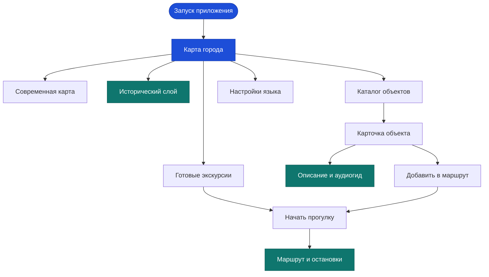

## 2. Объём первой версии

### 2.1. MVP — обязательный минимум

- [ ] Современная карта с приближением, перемещением и возвратом к городу.
- [ ] Геолокация в активном приложении, круг точности и ручной выбор старта.
- [ ] Исторический слой с переключателем эпох, прозрачностью и обозначением границ покрытия.
- [ ] Не менее 10 проверенных исторических объектов с источниками.
- [ ] Поиск, категории, карточки объектов, список как альтернатива карте.
- [ ] Не менее 2 готовых экскурсий с порядком остановок.
- [ ] Составление собственного маршрута из нескольких объектов с изменением порядка.
- [ ] Построение пешеходного пути по современной сети улиц, отображение длины и ориентировочного времени.
- [ ] Русский, английский и китайский языки интерфейса и основных материалов.
- [ ] Аудиогид на выбранном языке; понятная обработка отсутствия голосового пакета.
- [ ] Доступный интерфейс, обработка отсутствия сети, отказа в разрешениях и ошибок.
- [ ] APK, документация, тестовые отчёты и воспроизводимая сборка.

### 2.2. Дополнительные функции

| Приоритет | Возможность | Условие |
|---|---|---|
| P1 | Избранное, сохранение собственных экскурсий, дополнительные эпохи | После принятия MVP |
| P1 | Оптимизация порядка остановок, автоматическое перепостроение пути | Отдельные требования и тесты |
| P2 | Панорамы улиц или 3D | Только при наличии лицензированного источника данных; панорамы не являются прямой трансляцией |
| P2 | Офлайн-карта | Только если провайдер разрешает хранение карт и хватает ресурсов |
| P2 | Аккаунты, отзывы и фотографии | Нужен сервер, авторизация и модерация |
| P2 | Друзья и обмен геопозицией | Явное согласие, отзыв доступа, ограничения видимости, срока хранения и защита данных |

> [!NOTE]
> В MVP «навигация» означает показ позиции, линии маршрута и остановок. Полноценное пошаговое голосовое ведение, фоновый GPS и автоматическое перепостроение не входят в обязательный минимум. Новые функции не должны срывать сдачу базового продукта.

## 3. Технологии и инструменты

| Область | Инструмент | Практический результат |
|---|---|---|
| IDE | Android Studio | Проект, эмулятор, Logcat, профилирование |
| Язык | Kotlin | Реализация Android-приложения |
| Интерфейс | Jetpack Compose | Экраны, компоненты, темы и состояния |
| Сборка | Gradle Wrapper, Kotlin DSL, version catalog | Повторяемая сборка и закреплённые зависимости |
| Архитектура | ViewModel, StateFlow, Repository, Coroutines | Управление состоянием, разделение ответственности |
| Навигация между экранами | Jetpack Navigation | Переходы, аргументы, возврат |
| База | Room | Каталог, переводы, экскурсии и источники |
| Настройки | DataStore или штатные механизмы Android | Сохранение языка и пользовательских параметров |
| Карта | MapLibre Native Android | Отрисовка современной карты, маркеров, растра и маршрута |
| Картографические данные | OpenStreetMap + разрешённый провайдер стиля/тайлов | Базовый картографический слой с атрибуцией |
| GIS | QGIS | Геопривязка исторического плана и экспорт |
| Геолокация | Fused Location Provider при наличии GMS; Android LocationManager как вариант без GMS | Координаты и точность |
| Маршруты | openrouteservice или согласованный аналог | Пешеходный маршрут через заданные точки |
| Сеть | Retrofit / OkHttp | HTTP-запросы, тайм-ауты, обработка ошибок |
| Озвучка | Android TextToSpeech | Воспроизведение готового локализованного текста |
| Локализация | Android string resources + переводы данных | RU / EN / ZH |
| Контроль версий | Git + GitHub | Исходники, PR, Releases |
| Управление | GitHub Issues / Projects / Milestones | Задачи, приоритеты и прогресс |
| UX/UI | Figma / FigJam | Макеты и пользовательские сценарии |
| Спецификации | OpenSpec | Согласованные изменения требований и задачи |
| Документация | Markdown / Mermaid | ТЗ, архитектура, схемы, отчёты |
| QA | JUnit, AndroidX Test, Compose UI Test | Unit, integration, instrumented и UI-тесты |
| Проверка API | Postman / Bruno (при работе с внешним API) | Воспроизводимые запросы без секретов |
| CI | GitHub Actions | Проверки, сборка APK, тестовые артефакты |

**Не требуется:** React, TypeScript, Leaflet, браузерная геолокация, PWA, полноценный собственный backend для каталога. При наличии Java/XML в действующем проекте допустим эквивалентный стек с обоснованием в ADR. Не смешивать два UI-стека без технической причины.

В первую неделю команда фиксирует `minSdk`, `targetSdk`, `compileSdk`, версии JDK/Gradle/AGP и библиотек, доступность Google Play Services на тестовых устройствах и требования выбранного магазина. Рекомендуемый стартовый ориентир `minSdk` — 26, если парк устройств это позволяет; окончательное решение принимается после инвентаризации. Не выбирать версии наугад.

## 4. Команда и ответственность

| Роль | Обязательные артефакты |
|---|---|
| Team Lead / аналитик | ТЗ, backlog, контрольные точки, протоколы решений, интеграция |
| UX/UI | Figma, User Flow, UI Kit, прототип, результаты UX-проверок |
| Android Developer — UI | Экраны, навигация, состояния, локализация, доступность |
| Android Developer — Data / Integration | Room, репозитории, GPS, маршруты, TTS, обработка ошибок |
| GIS / контент | Исторические источники, QGIS, координаты, переводы и проверка фактов |
| QA / Release Engineer | Тест-план, дефекты, автоматизация, сборки и релиз |

При меньшей команде роли совмещаются; карта может быть выделена отдельному разработчику. На каждую роль назначается основной и резервный ответственный. Каждый студент имеет минимум одну самостоятельную проверяемую задачу на неделю, участвует в ревью или проверке чужой работы. Вклад GIS и UX подтверждается артефактами, а не количеством коммитов.

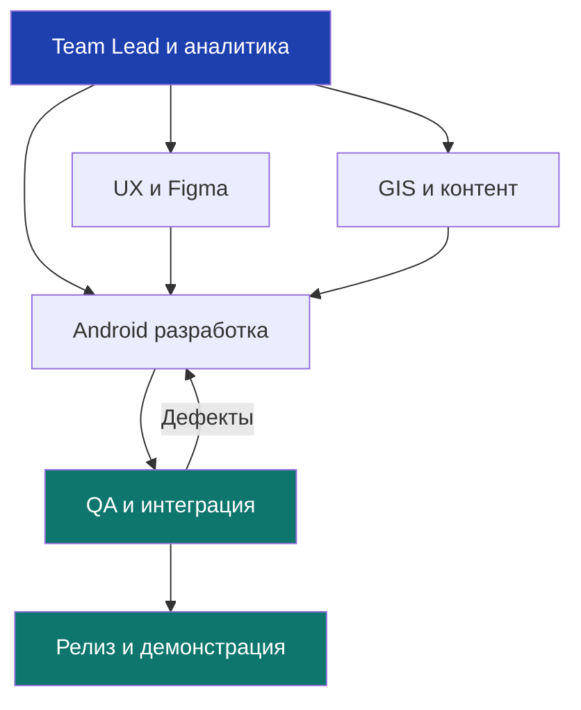

## 5. Техническое задание

### 5.1. Функциональные требования

P0 — обязательная функция; требования имеют стабильные идентификаторы, которые используются в Issues, PR и тестах.

| ID | Требование | Критерии приёмки |
|---|---|---|
| FR-01 | Современная карта | Загрузка карты, pan/zoom, видимая атрибуция; при выходе камеры за рабочую область сообщение и кнопка возврата. |
| FR-02 | Геопозиция | При разрешении отображаются координаты и точность; при отказе, отключении GPS, неточном разрешении или тайм-ауте доступен ручной старт. |
| FR-03 | Смена эпох | Слой 1889 года включается и выключается, регулируется прозрачность; позиция, выбранные точки и линия маршрута сохраняются. Вне покрытия — отдельное уведомление. |
| FR-04 | Исторические объекты | 10+ карточек, название, описание, категория, координаты, адрес при наличии, период, источники, изображение при наличии прав; поиск и фильтр работают. |
| FR-05 | Готовые экскурсии | 2+ экскурсии, описание, список остановок, длина/время при наличии расчёта; пользователь видит текущую остановку и может завершить прогулку. |
| FR-06 | Собственный маршрут | От GPS или ручного старта через 2+ выбранных объекта; добавление, удаление и перестановка; путь рассчитан по современной пешеходной сети. |
| FR-07 | Маршрут в реальном использовании | GPS обновляется в активном приложении, линия и остановки видны. При сбое маршрутизации отображается ошибка/повтор, а не фиктивная прямая линия. |
| FR-08 | Мультиязычность | RU/EN/ZH: меню, сообщения и утверждённый контент переведены; выбор языка сохраняется, состояние активной прогулки не теряется. |
| FR-09 | Аудиогид | Play/Stop, выбранный язык; нет голосового пакета — объяснение и текст, при выходе с экрана и завершении сеанса — корректное освобождение ресурсов. |
| FR-10 | Доступность | TalkBack, семантические подписи, достаточный контраст, масштабируемый текст, доступный список объектов и управление без зависимости только от цвета. |
| FR-11 | Ошибки и жизненный цикл | Нет сети, ошибки тайлов, API и пустые данные обработаны; нет падения при повороте, сворачивании, восстановлении и повторном входе. |

### 5.2. Нефункциональные требования

| ID | Требование | Проверка |
|---|---|---|
| NFR-01 | Совместимость | Эмулятор минимальной поддерживаемой версии и хотя бы два доступных реальных смартфона разных конфигураций (при недостатке устройств согласовать замену). |
| NFR-02 | Доступность | Целевой контраст 4,5:1 для обычного текста; интерактивные области от 48 dp; проверка TalkBack и увеличенного шрифта. |
| NFR-03 | Надёжность | Нет блокирующих падений в обязательных сценариях; 15-минутная проверочная прогулка или безопасная эмуляция. |
| NFR-04 | Производительность | После spike зафиксировать тестовое устройство и цели: ориентир холодного старта до 5 с, поиск локальных данных до 1 с; внешнюю задержку измерять отдельно. |
| NFR-05 | Безопасность | HTTPS для внешних запросов; секреты не в Git, APK или логах; отсутствие незащищённого хранения геоданных. |
| NFR-06 | Приватность | Запрашивать доступ к позиции по действию пользователя; только foreground-location, не отправлять позицию без необходимости; объяснить передачу координат маршрутизатору. |
| NFR-07 | Лицензии | Атрибуция карты, права на изображения и переводы, реестр источников и условия провайдеров. |
| NFR-08 | Поддерживаемость | Сборка из чистого клона по README; форматирование, понятные имена, тесты логики, документированные зависимости. |
| NFR-09 | Работа без сети | Локальный каталог и описания доступны. Карта/маршрут показывают статус недоступности; полный офлайн-режим не обещается. |

Необходимые разрешения объявляются в Manifest и запрашиваются по правилам соответствующей версии Android. `INTERNET` — обычное разрешение; `ACCESS_COARSE_LOCATION` и при необходимости `ACCESS_FINE_LOCATION` — runtime. Не запрашивать фоновые разрешения, контакты, микрофон или доступ к хранилищу для MVP без обоснования.

## 6. Проектирование в Figma

До разработки экранов согласовать прототип. Создать один командный файл с разделами `Research`, `User Flows`, `Wireframes`, `Design System`, `Screens`, `Prototype`, `Handoff`.

| Экран | Что должно быть в макете |
|---|---|
| Главная карта | GPS, возврат, эпохи, прозрачность, поиск, список, атрибуция |
| Каталог | Поиск, категории, пустой результат, переход к карточке |
| Карточка | Название, фото, описание, источник, озвучка, добавление в маршрут |
| Экскурсии | Список, длительность/длина, остановки, старт |
| Конструктор маршрута | Выбранные точки, изменение порядка, удаление, расчёт |
| Активная прогулка | Позиция, линия, остановки, текущая точка, завершение |
| Настройки | Язык, сведения о приложении, источники, приватность |
| Ошибки | Нет сети, отказ GPS, нет голоса, вне покрытия, не найден путь |

**Требования к макетам:** Auto Layout, компоненты и варианты, цветовые и текстовые стили, состояния default/pressed/disabled/loading/error. Проверить длинные английские и китайские тексты; жёлтая кнопка аудио допустима только с читаемым контрастом и текстовой/семантической подписью. Не перекрывать атрибуцию карты нижними панелями. Предусмотреть системные insets, портретную ориентацию и корректную реакцию на изменение размера.

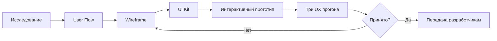

**Приёмка Figma:** ссылка с доступом преподавателя, кликабельные сценарии «найти объект», «сравнить эпохи», «начать экскурсию»; минимум три прогона с участниками и краткий протокол замечаний, исправления до G2. При передаче указать размеры, цвета, типографику, состояния и правила поведения компонентов.

## 7. Архитектура и данные

Рекомендуется один Android-модуль `app` с пакетами по ответственности. Для учебного MVP не обязательно создавать многомодульную Clean Architecture. Domain/use cases добавляются там, где логика сложна или переиспользуется.

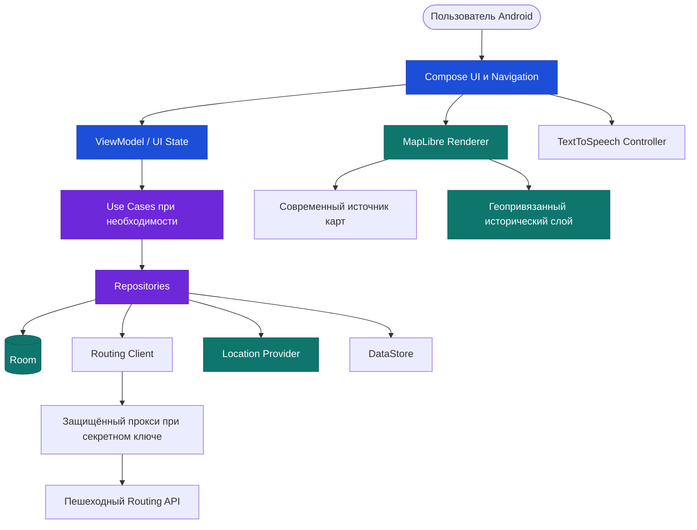

ViewModel хранит состояние интерфейса (эпоха, выбранные ID остановок, настройки маршрута), но не `Activity`, `MapView` или другие объекты с жизненным циклом экрана. Использовать `SavedStateHandle`/локальное сохранение для нужного состояния после уничтожения процесса; не пытаться сериализовать SDK-объекты. Контроллеры карты и TTS управляются с учётом жизненного цикла. Если SDK карты предоставляется через Android View, интегрировать через `AndroidView` с корректным управлением lifecycle, проверив совместимость на spike.

### 7.1. Модель Room

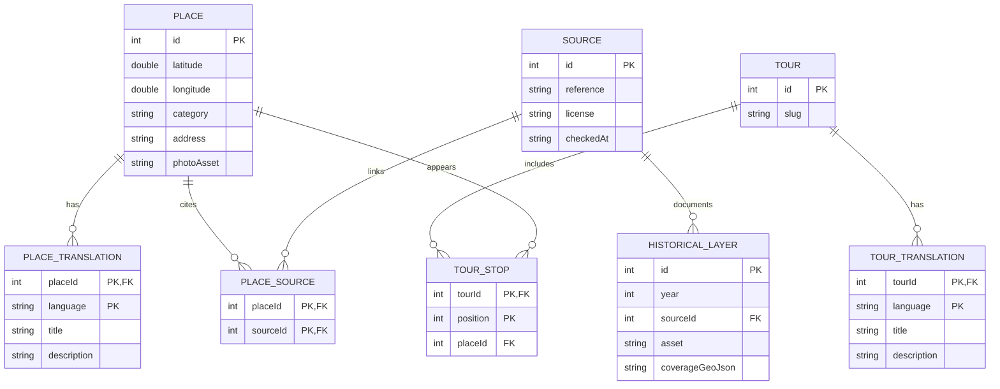

| Решение | Правило |
|---|---|
| Наполнение | Проверенный JSON/CSV или подготовленная база в assets, импорт/миграции воспроизводимы |
| Переводы | Уникальная пара ID + язык; явный fallback с отметкой, если перевод отсутствует |
| Координаты | Проверять широту/долготу и попадание объектов в согласованную рабочую область |
| Изображения | Только собственные или разрешённые; источник и лицензия обязательны |
| Пользовательские данные | Не хранить историю GPS в MVP; хранить настройки и при необходимости выбранные ID |
| Версии данных | Указывать версию набора, документировать обновление и миграцию Room |

### 7.2. Маршрутизация и сервер

Полноценный backend каталога не нужен. Секретный ключ стороннего API нельзя защитить, просто записав его в `local.properties`, BuildConfig или обфусцировав APK: ключ всё равно извлекается. Выбрать разрешённый провайдером клиентский токен с ограничениями либо небольшой HTTPS-прокси с серверным секретом, ограничением запросов и валидацией. Поставщик, доступность из региона, правила и квоты проверяются до утверждения архитектуры. Для локальных тестов — mock и fixtures без реального ключа.

Минимальный контракт прокси, **если требуется**:

| Метод | Вход | Выход |
|---|---|---|
| `POST /api/routes` | Старт и упорядоченные точки в GeoJSON-порядке координат | Геометрия, длина в метрах, время в секундах |
| `GET /health` | — | Статус доступности прокси без раскрытия секретов |

Ошибки: `400` неверный ввод, `429` квота, `502/503` недоступность сервиса; тайм-ауты, ограничение числа точек и частоты запросов. Не логировать точные позиции без необходимости. Пример контракта (координаты условные):

```json
{
  "profile": "foot-walking",
  "coordinates": [[127.53, 50.27], [127.54, 50.28], [127.55, 50.28]]
}
```

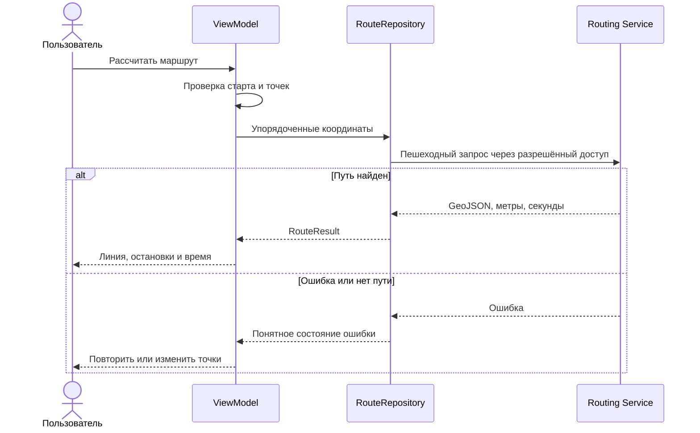

GeoJSON хранит координаты в порядке `[longitude, latitude]`, тогда как многие классы Android используют `(latitude, longitude)`. Тест преобразования обязателен. Исторический слой не участвует в расчёте пути. Не называть маршрут безопасным или безбарьерным без подтверждённых данных о доступности улиц.

## 8. Картография и исторические источники

### 8.1. Порядок подготовки слоя 1889 года

1. Найти оригинал/достоверную цифровую копию; записать архив, шифр или URL, дату, автора, условия воспроизведения. Не считать возраст карты автоматическим разрешением на использование конкретного цифрового файла.
2. Получить читаемый скан. В QGIS загрузить современную опорную карту с разрешённым использованием.
3. Выбрать устойчивые опорные точки по всей области (ориентир 6–10, если это позволяет источник). Зафиксировать контрольные точки, CRS и метод трансформации.
4. Проверить результат по независимым контрольным точкам; записать отклонения в метрах, ограничения точности и области с плохим совпадением.
5. Экспортировать геопривязанный растр и метаданные, при необходимости разбить на растровые тайлы. Для небольшого предварительно выровненного изображения проверить MapLibre `ImageSource`, для больших материалов — разрешённый `RasterSource`.
6. Раздельно определить рабочую границу города/экскурсии и геометрию покрытия исторического слоя. При выходе камеры или позиции за покрытие не показывать пустой растр как карту города.
7. Проверить слой на Android-устройстве: поворот, zoom, прозрачность, GPS поверх исторического слоя, линия маршрута и атрибуция.


**Граница ответственности:** существование пригодного скана 1889 года и права на него пока не подтверждены. К G1 — реестр найденных источников, к G2 — пригодный слой либо письменное согласование другой исторической даты/явно маркированного демонстрационного слоя. Не выдавать вымышленный план за исторический оригинал.

### 8.2. Контент и карты

`data/sources.csv` — обязательные колонки: `source_id,title,author,date,url_or_archive_id,license,checked_at,notes`. Для каждого объекта зафиксировать источники текста, координат и изображения, автора перевода/проверяющего. Проверять реальные места по современным данным. Маршруты желательно пройти лично или проверить по доступным источникам; не вести пользователей на частную территорию.

MapLibre — движок, а не поставщик бесплатных карт. Определить провайдера стилей и тайлов, правила нагрузки, атрибуцию и офлайн-хранение. Не скачивать массово тайлы публичных серверов OSM. Исторические неточности объяснять в интерфейсе.

## 9. GitHub и организация разработки

### 9.1. Настройка проекта

- Один командный репозиторий, например `blagoveshchensk-history-android`; преподаватель получает доступ на чтение, управление проектом согласовывается.
- GitHub Project: Backlog, Ready, In progress, Review, Testing, Done; Blocked — отдельный статус или метка. Поля: Assignee, Priority, Milestone, Estimate, Due date, Requirement.
- Метки: `feature`, `bug`, `documentation`, `design`, `gis`, `test`, `blocked`, `P0`, `P1`, `P2`.
- Шесть milestones по неделям. У задачи один основной исполнитель; для больших задач — подзадачи и зависимости.
- Ограничить незавершённую работу: ориентир одна активная задача на студента. Stand-up 5–10 минут ежедневно; еженедельные планирование, демо, ретроспектива.

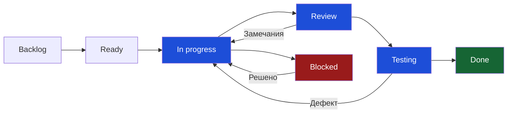

### 9.2. Git workflow

Основная ветка `main` должна собираться. Для задачи создаётся короткоживущая ветка `feature/42-map`, `fix/57-gps` или `docs/18-sources`. Долгоживущая `develop` не обязательна. Включить защиту `main`, требование PR, минимум одного независимого ревью и успешного CI, если это доступно на тарифе. Иначе соблюдать правила вручную и фиксировать проверки.

```bash
git switch main
git pull --ff-only
git switch -c feature/42-map
# Внести изменения и выполнить тесты.
git status
git add app/
git commit -m "feat(map): add city bounds"
git push -u origin feature/42-map
```

Открыть PR, добавить `Closes #42`, описание, список тестов и доказательства. Ревьюер проверяет критерии задачи, сборку, архитектуру, ошибки, секреты, тесты и документацию. После принятия — merge, удаление ветки, закрытие Issue. Не коммитить `.gradle/`, `build/`, `local.properties`, keystore, токены и персональные данные. Gradle Wrapper и его конфигурация должны быть в Git. Большие разрешённые GIS-материалы хранить согласованным способом (например, LFS или релизный asset) с инструкцией воспроизведения и checksum; проверить квоты.

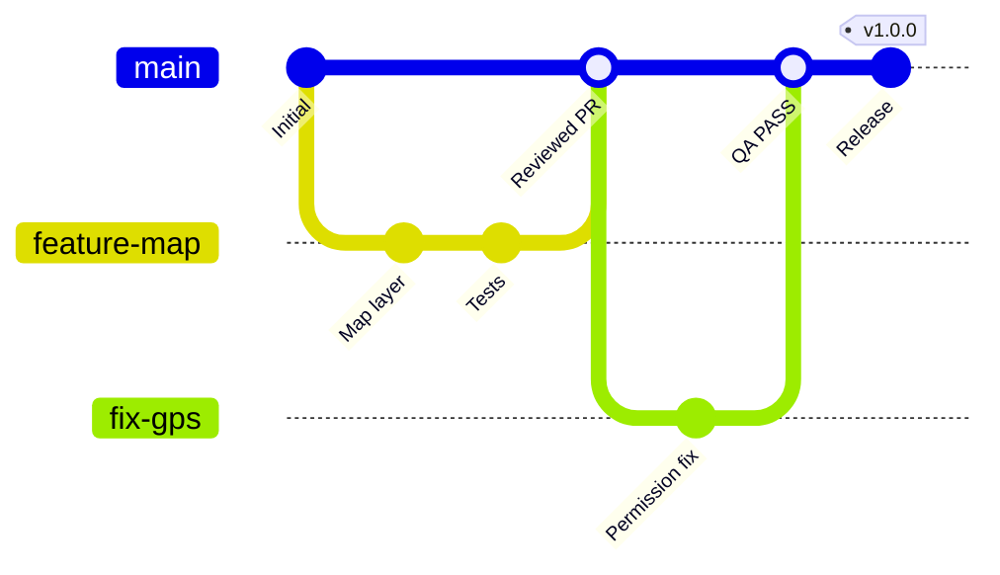

**Definition of Ready:** цель, FR-ID, критерии, исполнитель, приоритет, зависимости и срок определены. **Definition of Done:** критерии подтверждены, тесты выполнены, CI успешен, независимое ревью пройдено, PR принят, документация обновлена, доказательства приложены, блокирующие дефекты отсутствуют.

## 10. OpenSpec и работа с требованиями

OpenSpec используется для существенных изменений продукта, а не вместо GitHub Issues. Если команда применяет AI coding assistant, можно подключить официальный OpenSpec CLI; версию и порядок установки проверить по официальной документации. Наличие Node.js для CLI не означает, что Android-приложение должно разрабатываться на JavaScript. Если CLI недоступен, вести тот же процесс в Markdown вручную по согласованию.

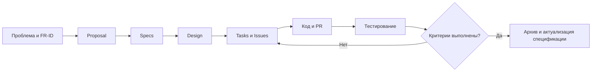

Пример структуры изменения:

```text
openspec/
  specs/
    historical-map/spec.md
  changes/
    add-historical-layer/
      proposal.md
      design.md
      tasks.md
      specs/historical-map/spec.md
```

- `proposal.md`: зачем изменение, границы и влияние на FR-03.
- `spec.md`: проверяемые требования и сценарии GIVEN/WHEN/THEN.
- `design.md`: варианты, SDK, риски, хранение состояния, покрытие.
- `tasks.md`: конкретные шаги и ссылки на Issues.
- После проверки — согласовать итоговые спецификации и архивировать изменение штатным способом выбранной версии OpenSpec.

Пример delta-спецификации:

```markdown
## ADDED Requirements

### Requirement: Historical layer switching
The application SHALL preserve the active route when switching map epochs.

#### Scenario: Switch epoch during a tour
- **GIVEN** a route and a location marker are visible
- **WHEN** the user enables the historical layer
- **THEN** the route and location marker remain visible
- **AND** an out-of-coverage notice is shown if appropriate
```

ИИ допустим по правилам преподавателя: студент фиксирует существенное применение, проверяет вывод, не передаёт секреты и способен объяснить код. Сгенерированный код без тестов и понимания не считается доказательством освоения материала.

## 11. Дорожная карта по дням

План рассчитан на шесть пятидневных недель. Даты на диаграмме условные, начало 30.11.2026 приведено исключительно для отрисовки. Преподаватель заменяет даты с учётом расписания, выходных и каникул.

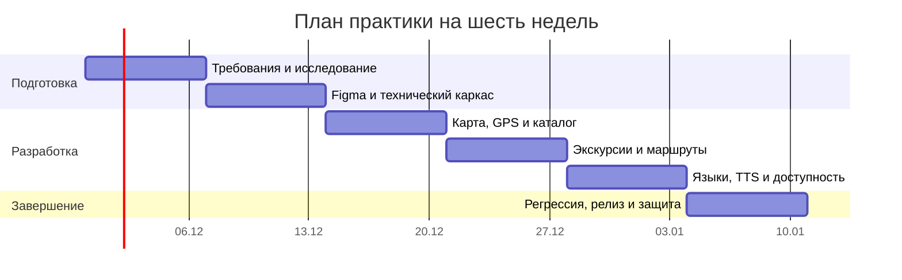

| Неделя | Этап | Контрольная точка | Результат |
|---|---|---|---|
| 1 | Анализ | G1 | Требования, backlog, проверка осуществимости |
| 2 | Проектирование | G2 | Figma, архитектура, геослой, запускаемый skeleton |
| 3 | Картография | G3 | Современная и историческая карта, GPS, каталог |
| 4 | Экскурсии | G4 | Полный основной сценарий маршрута |
| 5 | Локализация и QA | G5 | Feature complete, тесты и доступность |
| 6 | Выпуск | G6 | Проверенный APK, отчёты и защита |

### Неделя 1 — исследование и требования

| День | Действия | Проверяемый результат |
|---|---|---|
| 1 | Назначить роли, GitHub, Project, README, шаблоны, Milestone | Ссылки, исполнители, начальный backlog |
| 2 | Описать аудиторию, сценарии, FR/NFR, MVP, риски | ТЗ v1, User Flow |
| 3 | Поиск исторической карты, контента и прав; проверить OSM-провайдера | Реестр источников, решение о блокерах |
| 4 | Эскизы в Figma; Android SDK, minSdk и выбор библиотек | Wireframes, ADR о стеке |
| 5 | Spike MapLibre, GPS, routing API на устройстве; проверить RU/EN/ZH TTS | APK-прототип, логи/скриншоты, протокол G1 |

**G1:** принят объём MVP, распределены роли, доступен проект, есть evidence осуществимости ключевых технологий или план устранения блокеров.

### Неделя 2 — проектирование и каркас

| День | Действия | Проверяемый результат |
|---|---|---|
| 6 | Figma UI Kit, экраны карты, карточки и экскурсий | Компоненты и макеты |
| 7 | Кликабельный прототип, ошибки, три UX-прогона | Протокол и исправленные макеты |
| 8 | Пакеты Android, Room, репозитории, маршрутизация экранов | Схема, skeleton APK, тест сборки |
| 9 | QGIS, привязка и оценка точности; минимум 5 карточек | Геослой или согласованный fallback, реестр |
| 10 | CI, первый PR, mock routing, решения по ключам и разрешениям | Зелёный CI, архитектура, протокол G2 |

**G2:** прототип принят, проект собирается из чистого клона, определены API и данные, исторический слой готов к интеграции либо согласовано изменение FR-03.

### Неделя 3 — карта, GPS и каталог

| День | Действия | Проверяемый результат |
|---|---|---|
| 11 | Базовая карта, атрибуция, границы и возврат | FR-01, тест камеры |
| 12 | GPS, runtime permissions, точность, ручной старт | FR-02, разрешить/отказать |
| 13 | Исторический слой, прозрачность, покрытие | FR-03, скриншоты двух эпох |
| 14 | Room и импорт, маркеры, карточки | Данные и тесты DAO |
| 15 | Поиск/категории, 10 объектов, проверка состояния | FR-04, APK `v0.3.0`, G3 |

### Неделя 4 — маршруты и экскурсии

| День | Действия | Проверяемый результат |
|---|---|---|
| 16 | Две экскурсии, остановки и порядок | FR-05, реестр маршрутов |
| 17 | Конструктор маршрута и редактирование | FR-06, тесты порядка точек |
| 18 | Интеграция routing API, при необходимости прокси | Геометрия, метры, время, тайм-ауты |
| 19 | Отрисовка линии, режим прогулки, переключение эпох | FR-07, сохранение состояния |
| 20 | Проверка реального/эмулированного движения, отсутствие сети | APK `v0.4.0`, отчёт G4 |

### Неделя 5 — языки, аудио, доступность

| День | Действия | Проверяемый результат |
|---|---|---|
| 21 | Ресурсы RU/EN/ZH, переключение и сохранение | FR-08, скриншоты |
| 22 | Переводы карточек/экскурсий и независимая проверка | Полный утверждённый контент |
| 23 | TTS, play/stop, отсутствие пакета, lifecycle | FR-09, видео на устройстве |
| 24 | TalkBack, контраст, шрифты, доступный список | FR-10, чек-лист доступности |
| 25 | UI-тесты, сбои, поворот, профилирование | FR-11, `v0.9.0`, G5 |

### Неделя 6 — регрессия и защита

| День | Действия | Проверяемый результат |
|---|---|---|
| 26 | Полная регрессия по матрице требований | Отчёт, дефекты и приоритеты |
| 27 | Исправить P0/P1, повторно проверить, ревью | PR, результаты ретеста |
| 28 | Чистая сборка, APK, при необходимости AAB, лицензии | Release Candidate, инструкция |
| 29 | Установить APK на чистое устройство; подготовить презентацию | Протокол установки, индивидуальные отчёты |
| 30 | Защита, демонстрация, передача артефактов | G6, финальный релиз и оценка |

Приёмка G3–G6 проводится по соответствующим FR/NFR и тестам. Зависимые функции не принимаются на основании обещаний; независимые задачи можно делать параллельно. Если точка не принята, зафиксировать дефект, ответственного, срок и повторную проверку. После G5 — только исправления, документация и согласованные исключения.

## 12. Стартовый backlog

Создать Issues по этому списку. Номера в таблице — условные ID задач; реальные номера назначает GitHub. Для каждой указать конкретного исполнителя, срок, зависимости и критерии из раздела 5. Не закрывать задачей «реализовать всё приложение» весь проект.

| ID | Задача | Приоритет | Неделя | Результат / зависимость |
|---|---|---|---|---|
| B01 | Репозиторий, Project, роли и шаблоны | P0 | 1 | Ссылки и права доступа |
| B02 | ТЗ, MVP и FR/NFR | P0 | 1 | Принятое ТЗ |
| B03 | Поиск источника 1889 года | P0 | 1 | Реестр и права |
| B04 | Spike карты, GPS, маршрутов и TTS | P0 | 1 | APK, доказательства и ADR |
| B05 | User Flow и прототип Figma | P0 | 2 | Кликабельный прототип |
| B06 | Android skeleton, CI и навигация | P0 | 2 | B04, чистая сборка |
| B07 | Модель Room, импорт, источники | P0 | 2–3 | ERD, DAO и тесты |
| B08 | Геопривязка исторического слоя | P0 | 2 | B03, растр и метаданные |
| B09 | Современная карта и границы | P0 | 3 | FR-01, B06 |
| B10 | GPS и разрешения | P0 | 3 | FR-02, B09 |
| B11 | Переключение эпох | P0 | 3 | FR-03, B08–B10 |
| B12 | Каталог, карточки, поиск | P0 | 3 | FR-04, B07 |
| B13 | Готовые экскурсии | P0 | 4 | FR-05, B12 |
| B14 | Конструктор маршрута | P0 | 4 | FR-06, B12 |
| B15 | Routing client и защита доступа | P0 | 4 | FR-06/07, B04 |
| B16 | Активная прогулка и линия пути | P0 | 4 | FR-07, B11/B13–B15 |
| B17 | Локализация и переводы | P0 | 5 | FR-08 |
| B18 | Аудиогид и fallback | P0 | 5 | FR-09, B17 |
| B19 | TalkBack и доступность | P0 | 5 | FR-10 |
| B20 | Ошибки, lifecycle, регрессия | P0 | 5–6 | FR-11, NFR |
| B21 | Релиз и инструкция установки | P0 | 6 | APK, checksum и release notes |
| B22 | Итоговые отчёты и защита | P0 | 6 | Принятые артефакты |
| B23 | Избранное и дополнительные функции | P1/P2 | После MVP | Отдельное согласование |

## 13. Тестирование и качество

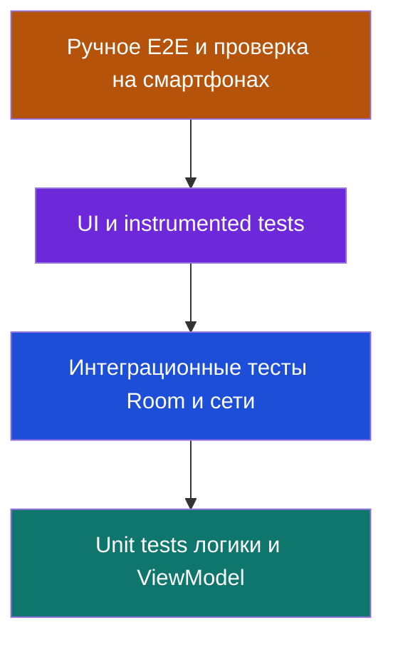

### 13.1. Виды тестов

| Вид | Что проверять | Инструмент |
|---|---|---|
| Unit | Координаты, порядок остановок, фильтры, состояние ViewModel, ошибки | JUnit, coroutine test, fakes |
| Integration | Room DAO, импорт, миграции, JSON и сетевые ответы | AndroidX Test, тестовая БД, MockWebServer |
| UI | Переходы, карточки, языки, ошибки, семантика кнопок | Compose UI Test или Espresso для XML |
| End-to-end | Полный маршрут от запуска до завершения | Эмулятор и реальный смартфон |
| GIS | Положение объектов, покрытие, совмещение эпох | QGIS и ручная проверка |
| Accessibility | TalkBack, шрифт, контраст, зоны нажатия | Android Accessibility Scanner / ручная проверка |
| Performance | Старт, поиск, память, батарея во время прогулки | Logcat, Android Profiler |
| Security | Отсутствие секретов, permissions, приватность | Ревью, проверка артефактов и логов |

### 13.2. Матрица приёмочных тестов

| TC | FR/NFR | Сценарий | Ожидаемый результат |
|---|---|---|---|
| TC-01 | FR-01 | Zoom, pan, выход камеры за границу | Уведомление, возврат к городу, атрибуция видна |
| TC-02 | FR-02 | Точная/примерная позиция, разрешение дано | Маркер и круг точности, без ложной точности |
| TC-03 | FR-02 | Отказ, GPS выключен, тайм-аут | Нет падения; ручной старт доступен |
| TC-04 | FR-03 | Смена эпох при активной прогулке | GPS, маршрут, порядок и состояние сохранены |
| TC-05 | FR-03 | Выход за покрытие старого плана | Сообщение, современная карта или возврат |
| TC-06 | FR-04 | Поиск по названию и категории | Ожидаемые карточки с источниками |
| TC-07 | FR-04 | Пустой результат / нет картинки | Понятное состояние и placeholder |
| TC-08 | FR-05 | Начать готовую экскурсию | Заданный порядок и активная остановка |
| TC-09 | FR-06 | Изменить порядок, удалить точку | Новый корректный запрос/пересчёт |
| TC-10 | FR-06/07 | Проверка пешеходного пути | Геометрия современного пути, корректные единицы |
| TC-11 | FR-07 | 429, 5xx, тайм-аут, нет пути | Контролируемая ошибка, повтор без фиктивного пути |
| TC-12 | FR-07 | Движение и изменение точности | Позиция обновляется, карта не блокирует управление |
| TC-13 | FR-08 | RU → EN → ZH, повторный запуск | Выбранный язык сохранён, маршрут не потерян |
| TC-14 | FR-09 | Play/Stop, смена языка | Корректный текст и управление воспроизведением |
| TC-15 | FR-09 | Голос отсутствует / TTS не инициализируется | Объяснение, доступен текст |
| TC-16 | FR-10 | TalkBack, увеличенный текст, контраст | Ключевые действия доступны, список читается |
| TC-17 | FR-11 | Поворот, фон, восстановление процесса | Согласованное состояние, нет утечек/падений |
| TC-18 | FR-11, NFR-09 | Отключить интернет | Каталог читается, карта и маршрут честно сообщают статус |
| TC-19 | NFR-01/03 | Установка и прогулка на реальных устройствах | Нет блокирующих сбоев; записана среда |
| TC-20 | NFR-04 | Замер старта, поиска и памяти | Измеренные значения против согласованных целей |
| TC-21 | NFR-05/06 | Проверить APK, Git, permissions, логи | Нет секретов и лишнего сбора геоданных |
| TC-22 | NFR-07 | Проверить источники, карту и лицензии | Атрибуция и реестр полны |
| TC-23 | NFR-08 | Собрать из чистого клона | Воспроизводимый успешный build |
| TC-24 | FR-04/05 | Импорт и целостность Room | Все связи, локали и порядок остановок валидны |
| TC-25 | FR-06 | Поменять порядок lat/lon в тестовых данных | Тест обнаруживает ошибку преобразования |

Статусы: `PASS`, `FAIL`, `BLOCKED`, `NOT RUN`. Все строки до фактического прогона имеют `NOT RUN`. Нельзя подменять фактический результат ожидаемым. Рекомендуемый минимальный объём автоматизации — 10 содержательных unit-тестов и 3 UI/integration-сценария; ручная матрица выполняется полностью. Отсутствие технической возможности автоматизировать часть сценариев обосновать.

### 13.3. Жизненный цикл дефекта

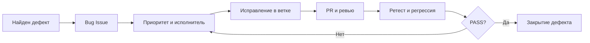

| Severity | Описание | Пример |
|---|---|---|
| Critical | Нельзя пользоваться приложением; риск безопасности | Падение при старте, утечка ключа |
| Major | Нарушена обязательная функция | Маршрут сбрасывается при смене эпохи |
| Minor | Не блокирует основной сценарий | Некритичный визуальный дефект |
| Trivial | Косметическая проблема | Незначительная опечатка |

Severity показывает влияние, Priority — порядок исправления. Релизный gate: нет открытых Critical и Major по MVP, нет утечки данных, все P0 приняты; остальные известные проблемы описаны и согласованы. Реальный сервис проверяется отдельно от mock; mock-демо не выдаётся за рабочую маршрутизацию.

### 13.4. CI/CD

Для каждого PR GitHub Actions выполняет на чистом runner: checkout, установка закреплённой версии JDK, настройка Gradle, unit-тесты, lint, сборка debug APK, публикация отчётов и APK как артефактов. UI/instrumented tests выполняются на выделенном эмуляторе или локальном устройстве; включить в CI при наличии стабильной среды.

Пример локальных команд (Windows CMD, из корня проекта):

```bat
gradlew.bat --version
gradlew.bat testDebugUnitTest lintDebug assembleDebug
REM При подключённом устройстве или запущенном эмуляторе:
gradlew.bat connectedDebugAndroidTest
```

Linux runner: `./gradlew testDebugUnitTest lintDebug assembleDebug`; при наличии эмулятора — `./gradlew connectedDebugAndroidTest`. Имена задач зависят от настроек модуля и build variants. Если используются другие варианты — прописать реальные команды в README. Не считать debug APK магазинным релизом.

## 14. Сборка и релиз

| Версия | Результат |
|---|---|
| v0.1.0 | Проверка технической осуществимости |
| v0.2.0 | Каркас приложения |
| v0.3.0 | Карта, GPS, исторический слой, каталог |
| v0.4.0 | Маршруты и экскурсии |
| v0.9.0 | Все функции MVP, начало финальной регрессии |
| v1.0.0-rc.1 | Кандидат после исправлений |
| v1.0.0 | Принятый итоговый релиз |

Перед релизом:

- [ ] Зафиксированы `versionName` и возрастающий `versionCode`.
- [ ] Выполнены сборка, lint и тесты из чистого клона.
- [ ] Подготовлен устанавливаемый APK, проверен на чистом физическом устройстве.
- [ ] Если нужна публикация в магазине — подготовлен подписанный артефакт требуемого формата, например AAB для Google Play; проверены актуальные условия RuStore/Google Play.
- [ ] Ключи подписи и пароли хранятся у назначенного ответственного, не в Git.
- [ ] Добавлены сведения об источниках, лицензиях, приватности и ограничениях.
- [ ] Git tag и GitHub Release соответствуют проверенному commit SHA.
- [ ] В релизе есть APK, инструкция установки, SHA-256, release notes и известные проблемы.
- [ ] Преподаватель имеет доступ к репозиторию, Figma и отчётам.

Публикация в магазине — дополнительный результат при наличии согласования, аккаунта разработчика, прав на материалы и выполнения правил магазина. Учебная приёмка не зависит от сроков модерации. CI-сборка debug APK не должна требовать секретов production.

## 15. Документация и отчётность

### 15.1. Структура репозитория

```text
blagoveshchensk-history-android/
├── app/
│   ├── src/main/
│   │   ├── java/.../                 # Kotlin-файлы проекта
│   │   │   ├── ui/                   # экраны, тема, навигация
│   │   │   ├── domain/               # логика (если нужна)
│   │   │   ├── data/                 # Room, DTO, repositories
│   │   │   ├── map/                  # слои, маркеры, линия
│   │   │   ├── location/             # доступ к GPS
│   │   │   └── audio/                # управление TTS
│   │   ├── res/values/strings.xml
│   │   ├── res/values-en/strings.xml
│   │   ├── res/values-zh/strings.xml
│   │   ├── assets/                   # разрешённые материалы
│   │   └── AndroidManifest.xml
│   ├── src/test/
│   ├── src/androidTest/
│   └── build.gradle.kts
├── gradle/
│   └── libs.versions.toml
├── data/
│   ├── sources.csv
│   └── gis/                          # метаданные и скрипты подготовки
├── docs/
│   ├── practice-plan.md              # настоящий регламент
│   ├── requirements.md
│   ├── architecture.md
│   ├── data-model.md
│   ├── gis.md
│   ├── api.md                        # при наличии API/прокси
│   ├── design.md                     # ссылки на Figma
│   ├── test-plan.md
│   ├── test-report.md
│   ├── user-guide.md
│   ├── release.md
│   ├── privacy.md
│   ├── adr/
│   └── reports/
│       ├── week-01.md
│       └── individual/
├── openspec/
├── .github/
│   ├── ISSUE_TEMPLATE/
│   ├── workflows/
│   └── pull_request_template.md
├── gradlew
├── gradlew.bat
├── settings.gradle.kts
├── build.gradle.kts
├── .gitignore
├── README.md
├── CONTRIBUTING.md
└── CHANGELOG.md
```

Путь к Kotlin-коду зависит от шаблона Android Studio: `src/main/java/` или `src/main/kotlin/`. Структура — рекомендация, не требование создавать пустые папки.

| Артефакт | Что сдавать |
|---|---|
| README | Назначение, скриншоты, стек, участники, точные шаги сборки и тестирования, Figma, Release |
| requirements.md | FR/NFR, критерии, приоритеты и согласованные изменения |
| architecture.md / data-model.md | Mermaid-схемы, Room, состояние, зависимости |
| gis.md / sources.csv | Источники, права, покрытие, CRS, ошибка геопривязки, способ воспроизведения |
| api.md | Контракт, примеры, ошибки, квоты, авторизация без реального ключа |
| design.md | Figma, навигация, доступность и дизайн-система |
| ADR | Альтернативы, выбор, причины, последствия |
| test-plan.md / test-report.md | Кейсы, версия, среда, фактические результаты и дефекты |
| user-guide.md | Установка и использование, ограничения, разрешения |
| release.md / CHANGELOG | Сборка, версия, SHA, изменения, известные проблемы |
| privacy.md | Какие данные используются, кому передаются, как обрабатываются |
| reports | Еженедельный отчёт команды и личные журналы |

### 15.2. Периодичность

| Частота | Ответственный | Содержание |
|---|---|---|
| Ежедневно | Каждый студент | Issue/PR, результат, доказательство, блокер и план |
| Раз в неделю | Team Lead и команда | План/факт, прогресс FR, тесты, вклад участников и риски |
| После каждого G1–G6 | Преподаватель | Приёмка или доработка с конкретными замечаниями |
| При смене архитектуры | Инициатор и ревьюер | ADR и при необходимости OpenSpec |
| На защите | Каждый студент | Индивидуальная демонстрация, отчёт, объяснение своего решения |

Отчётность ведётся в GitHub, а не только в мессенджере. Скриншот без ссылки на задачу или версию не является достаточным доказательством. Персональные данные реальных пользователей в отчёты и публичный репозиторий не помещать.

## 16. Оценивание и защита

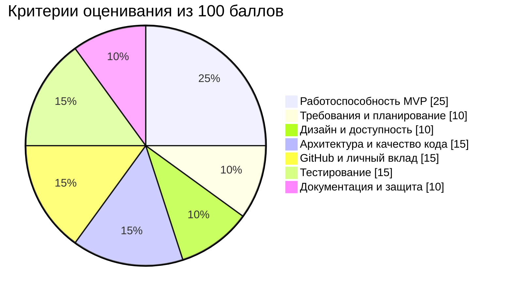

| Критерий | Баллы | Тип | Доказательство |
|---|---:|---|---|
| Работоспособность MVP | 25 | Командный | APK, FR-01–11, demo |
| Требования и планирование | 10 | Индивидуальный | Issues, спецификации, личное планирование |
| Дизайн и доступность | 10 | Командный | Figma, UX, TalkBack |
| Архитектура и качество кода | 15 | Командный | Схемы, код, безопасность и поддерживаемость |
| GitHub и личный вклад | 15 | Индивидуальный | PR, ревью, история артефактов |
| Тестирование | 15 | Индивидуальный | Свои тесты, ретест, проверка чужих задач |
| Документация и защита | 10 | Индивидуальный | Личный отчёт и ответы |
| **Итого** | **100** | **50 + 50** | |

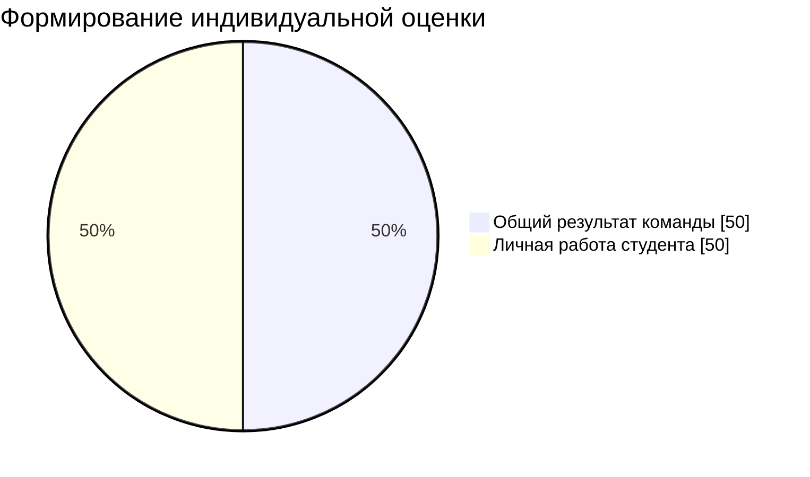

По каждому критерию преподаватель выставляет до указанного максимума: полное выполнение с доказательствами — 100% баллов критерия; частичное выполнение — 25–75% в зависимости от качества; отсутствие результата или доказательств — 0. Для недочётов фиксировать конкретную причину. Количество коммитов, строк кода и часов само по себе не определяет оценку.

| Баллы | Предлагаемая оценка |
|---:|---|
| 90–100 | Отлично |
| 75–89 | Хорошо |
| 60–74 | Удовлетворительно |
| 0–59 | Требуется доработка / неудовлетворительно по правилам учебного заведения |

### 16.1. Сценарий защиты — 20 минут

| Время | Содержание |
|---|---|
| 2 мин | Проблема, аудитория, MVP |
| 3 мин | Figma, архитектура, Room и GIS |
| 6 мин | Живая демонстрация Android: карта, GPS, смена эпох, маршрут, язык, аудио |
| 3 мин | GitHub Project, PR, CI, тесты и дефекты |
| 6 мин | Индивидуальные результаты и вопросы |

При недоступности внешней сети допустимо показать заранее записанное доказательство и mock-режим, явно обозначив это. Не скрывать незавершённые функции. Каждый участник объясняет своё решение, демонстрирует собственный артефакт и отвечает на технические вопросы. При необходимости преподаватель увеличивает время индивидуальной части.

## 17. Риски и развитие проекта

| Риск | Влияние | Меры | Ответственный |
|---|---|---|---|
| Нет пригодного плана 1889 | Высокое | Проверить в неделю 1, согласовать замену к G2 | GIS / Lead |
| Геопривязка неточная | Высокое | Контрольные точки, независимая проверка, отметка погрешности | GIS |
| API или тайлы недоступны в регионе | Высокое | Spike, запасной разрешённый провайдер, fixtures, прокси при необходимости | Integration |
| Нет китайского голоса TTS | Среднее | Проверить устройства, лицензированная запись или согласованный TTS-сервис; текстовый fallback | Android / QA |
| Нет GMS | Среднее | Проверить парк устройств, LocationManager при необходимости | Android |
| Ключ попал в Git или APK | Высокое | Серверный секрет, ограниченный клиентский токен, отзыв скомпрометированного ключа | Lead / QA |
| Непроверенный контент | Высокое | Источники, независимое ревью и указание неопределённости | GIS / контент |
| Нехватка времени | Высокое | Scope freeze, P0 первым, не начинать P1/P2 до MVP | Lead |
| Недостаток смартфонов | Среднее | Раннее планирование устройств, эмуляторы, согласованная замена | QA |
| Конфликты и зависимость от одного человека | Среднее | Малые PR, взаимное ревью, резервный ответственный | Lead |

### 17.1. Социальные функции после MVP

Аккаунты, друзья и фотоотзывы требуют отдельного backend, авторизации, контроля доступа, безопасного хранения, удаления данных и полноценной проверки угроз. Для друзей геопозиция передаётся только при осознанном согласии обеих сторон, с возможностью отключения, блокировки и ограничением времени/аудитории.

Для отзывов стоп-лист — лишь первый фильтр: нормализация текста, очередь ручной модерации, жалобы, лимиты загрузки и удаление EXIF из фотографий, контроль типов файлов и защита от злоупотреблений. Стоп-лист не заменяет модерацию и не должен публиковать опасный или приватный контент при обходе фильтра. Эти функции не являются критерием приёмки первой версии.

## 18. Шаблоны документов

Ниже готовые шаблоны для копирования в отдельные Markdown-файлы и GitHub Issues. Пустые поля заполняются студентами по фактическим результатам.

### 18.1. GitHub Issue — функция

```markdown
# [FR-03] Переключение исторического слоя

## Цель
Пользователь сравнивает эпохи без потери активного маршрута.

## Критерии приёмки
- [ ] Переключение слоя и изменение прозрачности работают.
- [ ] GPS, остановки и линия маршрута сохраняются.
- [ ] Вне покрытия появляется понятное уведомление.
- [ ] TC-04 и TC-05 пройдены.

## Организация
- Исполнитель: @username
- Приоритет: P0
- Milestone: неделя 3
- Зависимости: подготовленный геослой, карта и GPS
- Оценка трудоёмкости:
- Срок:

## Доказательства
- PR:
- Тесты:
- Скриншот или видео:
```

### 18.2. Pull Request — `.github/pull_request_template.md`

```markdown
## Что изменено

Closes #ISSUE_NUMBER

## Почему / FR-ID

## Как проверить
1.
2.
3.

## Доказательства
- Версия / commit:
- Скриншот / видео:
- Результаты тестов:

## Чек-лист
- [ ] Критерии Issue выполнены.
- [ ] Сборка, lint и тесты успешны.
- [ ] Ошибки и пограничные состояния проверены.
- [ ] Нет секретов и персональных данных.
- [ ] Документация обновлена.
- [ ] Назначен независимый ревьюер.
```

### 18.3. Bug report

```markdown
# [BUG] Краткое описание

- Severity: Critical / Major / Minor / Trivial
- Priority: P0 / P1 / P2
- Связанное требование: FR-XX
- Версия / SHA:
- Устройство / Android:
- Предусловия:

## Шаги воспроизведения
1.
2.
3.

## Ожидаемый результат

## Фактический результат

## Доказательства
Лог без секретов, скриншот или видео.

## Ретест
- PR:
- Версия исправления:
- Результат: PASS / FAIL / NOT RUN
```

### 18.4. Ежедневный индивидуальный отчёт

```markdown
# Индивидуальный отчёт за YYYY-MM-DD

Студент:
Роль:

| Задача / Issue | Что выполнено | Статус | Доказательство |
|---|---|---|---|
| #XX | | | ссылка на PR / Figma / тест |

## Проверки
- Что протестировано:
- Результаты:

## Блокеры и причины

## План следующего рабочего дня

## Затраченное время (фактическое)
```

### 18.5. Еженедельный командный отчёт

```markdown
# Отчёт команды — неделя N

Период:
Версия приложения / SHA:
Контрольная точка: G1–G6

## План и факт
| Issue | План | Факт | Статус | Ссылка |
|---|---|---|---|---|
| #XX | | | | |

## Приёмка требований
| FR/NFR | Статус | Тест | Доказательство |
|---|---|---|---|
| FR-XX | | TC-XX | |

## Вклад участников
| Студент | Выполненные задачи | Ревью / проверки | Артефакты |
|---|---|---|---|
| | | | |

## Качество
PASS: __ / FAIL: __ / BLOCKED: __ / NOT RUN: __
Открытые Critical/Major:
Ссылка на CI:

## Риски и решения

## План следующей недели

## Демонстрация
- GitHub Project:
- Figma:
- APK / Release:

## Приёмка преподавателем
Принято / на доработку:
Замечания и срок повторной проверки:
```

### 18.6. Тест-кейс

```markdown
# TC-XX — название

- Требование: FR-XX / NFR-XX
- Версия / SHA:
- Устройство, версия Android:
- Исполнитель и дата:
- Предусловия:
- Тестовые данные:

| Шаг | Действие | Ожидаемый результат | Фактический результат |
|---|---|---|---|
| 1 | | | |
| 2 | | | |

Статус: NOT RUN / PASS / FAIL / BLOCKED
Дефект: #XX (если обнаружен)
Доказательство:
```

### 18.7. ADR — архитектурное решение

```markdown
# ADR-001 — выбор SDK карты

Статус: proposed / accepted / superseded
Дата:
Ответственный:

## Контекст

## Варианты
- Вариант A:
- Вариант B:

## Решение и причины

## Последствия и риски

## Проверка (spike / тест)

## Связанные требования и Issues
```

### 18.8. Протокол контрольной точки

```markdown
# G<N> — протокол приёмки

Дата:
Версия / commit:
Участники:

| Критерий | Доказательство | PASS / FAIL / BLOCKED |
|---|---|---|
| | | |

Решение: принято / на доработку

| Замечание | Исполнитель | Срок | Ретест |
|---|---|---|---|
| | | | |

Подтверждение преподавателя:
```

### 18.9. Карточка исторического объекта

```markdown
# Исторический объект — <название>

- ID:
- Категория:
- Адрес:
- Широта / долгота:
- Исторический период:
- Источник фактов (URL или архивный шифр):
- Источник изображения и лицензия:
- Дата проверки:
- Автор / проверяющий:

## Русский
Название:
Описание:

## English
Title:
Description:

## 中文
名称：
介绍：

## Примечания и ограничения точности
```

## 19. Первый рабочий день

До конца первого дня команда должна предоставить:

- [ ] Название команды, участников, роли и ответственных.
- [ ] Ссылку на GitHub-репозиторий и доступ преподавателя.
- [ ] Ссылку на GitHub Project с колонками и milestones.
- [ ] README с паспортом проекта и выбранной платформой Android.
- [ ] 12–18 первичных Issues с исполнителями и критериями (добавить остальные по мере декомпозиции).
- [ ] Командный Figma-файл.
- [ ] Задачу на поиск плана 1889 года и проверку прав.
- [ ] Задачу на технический spike MapLibre, GPS, маршрутов и TTS.
- [ ] Первые индивидуальные отчёты.

К концу недели 1 преподаватель согласует окончательный объём, срок, стек, источники, тестовые устройства, ограничения и критерии оценивания. До этого не начинать реализацию необязательных функций. Технические эксперименты разрешены.

> [!IMPORTANT]
> Задача считается выполненной не тогда, когда студент о ней сообщил, а когда результат можно открыть, воспроизвести и проверить. Цель практики — работающий продукт и доказуемая инженерная работа каждого участника.

## 20. Официальные ресурсы

| Ресурс | Назначение |
|---|---|
| [Android Developers](https://developer.android.com/) | Android SDK, Studio, Kotlin, Compose |
| [Android architecture recommendations](https://developer.android.com/topic/architecture/recommendations) | Архитектура, UI и data layers |
| [Jetpack Compose testing](https://developer.android.com/develop/ui/compose/testing) | Тестирование интерфейса |
| [Room](https://developer.android.com/training/data-storage/room) | Локальная база данных |
| [Location permissions](https://developer.android.com/develop/sensors-and-location/location/permissions) | Геолокация и runtime permissions |
| [TextToSpeech](https://developer.android.com/reference/android/speech/tts/TextToSpeech) | Android TTS |
| [Android accessibility](https://developer.android.com/guide/topics/ui/accessibility) | Доступность |
| [App signing](https://developer.android.com/studio/publish/app-signing) | Подпись Android-приложения |
| [MapLibre Native Android](https://maplibre.org/maplibre-native/android/api/) | SDK карты и источники |
| [MapLibre Style Specification](https://maplibre.org/maplibre-style-spec/sources/) | Источники и слои карт |
| [OpenStreetMap attribution](https://www.openstreetmap.org/copyright) | Атрибуция и лицензия данных |
| [OSM Tile Usage Policy](https://operations.osmfoundation.org/policies/tiles/) | Правила использования тайлов |
| [QGIS Documentation](https://docs.qgis.org/) | Georeferencer и GIS |
| [openrouteservice](https://openrouteservice.org/) | Маршруты, API и ограничения |
| [GitHub Docs](https://docs.github.com/) | GitHub Issues, Projects, PR, Actions |
| [GitHub Mermaid diagrams](https://docs.github.com/en/get-started/writing-on-github/working-with-advanced-formatting/creating-diagrams) | Отрисовка диаграмм в Markdown |
| [Mermaid Live Editor](https://mermaid.live/) | Редактирование и проверка схем |
| [Figma Help](https://help.figma.com/) | Макеты, компоненты, прототипы |
| [OpenSpec](https://github.com/Fission-AI/OpenSpec) | Spec-driven development и CLI |

---

**Решения, требующие утверждения:** шестинедельный график, состав команды, Kotlin/Compose либо сохранение действующего Java/XML, минимальные версии Android, провайдеры карты и маршрутизации, пригодность и права на план 1889 года, наличие нужных TTS-голосов, количественные минимумы контента и тестов, шкала оценивания. Ни наличие скана, ни доступность сервисов на студенческих устройствах данным документом не подтверждаются. Проверки выполняются командой по контрольным точкам.

**Как использовать документ:** поместить его в `docs/practice-plan.md` репозитория и дать ссылку в README. GitHub отрисовывает Markdown-таблицы, чек-листы и Mermaid-блоки. В обычном текстовом редакторе диаграммы будут видны как исходный текст; для просмотра нужен совместимый Markdown-renderer. Схемы описывают плановую архитектуру, а не уже реализованное приложение.
