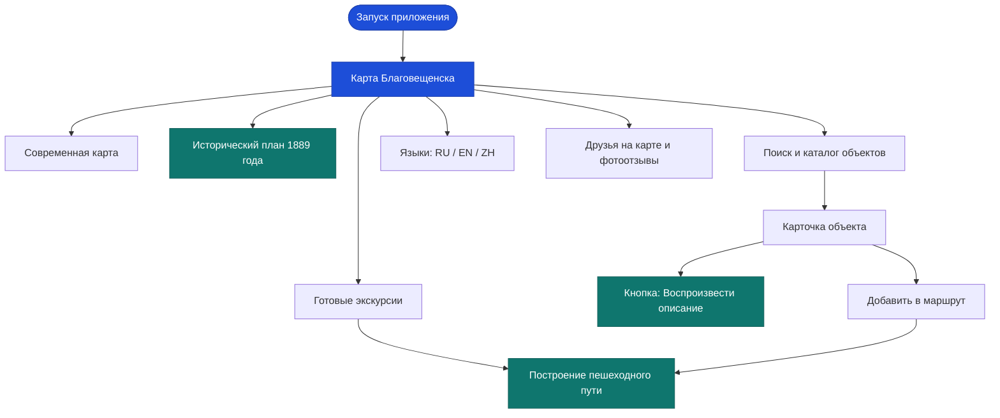
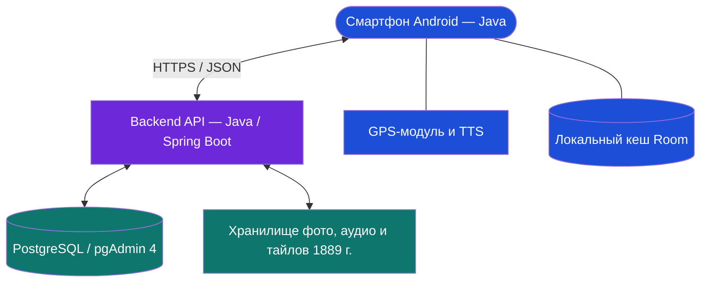
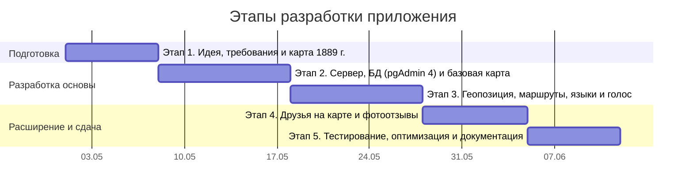

# Благовещенск: два времени

**Проектная документация по учебной практике: мобильный исторический путеводитель для Android**

| Параметр | Значение |
|---|---|
| Образовательная организация | Благовещенский филиал Финуниверситета |
| Специальность | 09.02.07 «Информационные системы и программирование» |
| Учебная группа | 328 |
| Состав команды | Сергиенко А.С., Татаурова Е.Е., Шумкова Е.В., Шамонина А.А., Поляков И.В. (5 человек) |
| Руководитель практики | Н.М. Вдовенко |
| Среда и язык разработки | Android Studio, Java (клиент-серверная архитектура) |
| Платформа | Android (смартфоны), разработка на рабочих станциях Windows |
| Год | 2026 |

> [!IMPORTANT]
> Документ описывает разработку нативного Android-приложения на языке **Java** с клиент-серверной архитектурой и базой данных **PostgreSQL** (администрирование через **pgAdmin 4**).

## Содержание

1. [Цель, актуальность и продукт](#1-цель-актуальность-и-продукт)
2. [Объём первой версии и приоритеты](#2-объём-первой-версии-и-приоритеты)
3. [Технологии и инструменты](#3-технологии-и-инструменты)
4. [Команда и ответственность](#4-команда-и-ответственность)
5. [Техническое задание](#5-техническое-задание)
6. [Проектирование интерфейса](#6-проектирование-интерфейса)
7. [Архитектура и данные](#7-архитектура-и-данные)
8. [Картография и исторические источники](#8-картография-и-исторические-источники)
9. [Репозиторий и организация разработки](#9-репозиторий-и-организация-разработки)
10. [Работа с требованиями и декомпозиция](#10-работа-с-требованиями-и-декомпозиция)
11. [Дорожная карта разработки](#11-дорожная-карта-разработки)
12. [Стартовый backlog](#12-стартовый-backlog)
13. [Тестирование и качество](#13-тестирование-и-качество)
14. [Сборка и релиз](#14-сборка-и-релиз)
15. [Документация и отчётность](#15-документация-и-отчётность)
16. [Критерии успешности и приёмка](#16-критерии-успешности-и-приёмка)
17. [Риски и развитие проекта](#17-риски-и-развитие-проекта)
18. [Шаблоны рабочих артефактов](#18-шаблоны-рабочих-артефактов)
19. [Старт проекта (первые шаги)](#19-старт-проекта-первые-шаги)
20. [Используемые инструменты и ресурсы](#20-используемые-инструменты-и-ресурсы)

---

## 1. Цель, актуальность и продукт

Современные навигационные сервисы (2ГИС, Яндекс Карты) ориентированы на современную инфраструктуру города и не позволяют увидеть, как выглядел Благовещенск более ста лет назад. **Цель проекта** — разработать удобное мобильное приложение «Благовещенск: два времени» для пешей навигации и самостоятельных экскурсий по Благовещенску Амурской области с возможностью мгновенного сравнения современной городской среды и исторического плана 1889 года.

| Целевая аудитория | Потребность | Основной сценарий |
|---|---|---|
| Жители Благовещенска и области | Узнать историю знакомых улиц и зданий | Переключить карту на 1889 год во время прогулки и изучить карточки мест |
| Туристы из регионов России | Самостоятельно осмотреть город без гида | Выбрать достопримечательности и пройти по пешеходному маршруту |
| Иностранные гости (в т.ч. из КНР) | Понятная навигация и информация на родном языке | Переключить язык (RU / EN / ZH) и включить голосовое озвучивание |
| Слабовидящие и пожилые люди | Доступное восприятие информации | Использовать крупные жёлтые контрастные кнопки и аудиовоспроизведение |
| Компании друзей и молодёжь | Совместные прогулки и обмен впечатлениями | Отслеживать друзей на карте и оставлять отзывы с фотографиями |



## 2. Объём первой версии и приоритеты

### 2.1. Высокий приоритет (базовая основа и ключевой сценарий)

- [ ] Подготовка и геопривязка исторической карты Благовещенска 1889 года, проверка работы двух слоёв.
- [ ] Настройка репозитория, клиент-серверного взаимодействия, базы данных и загрузки карточек объектов.
- [ ] Определение текущей геопозиции телефона, ограничение рабочей области границами Благовещенска и переключение между современной и старой картами без сброса позиции.
- [ ] Регистрация аккаунтов, добавление друзей и отслеживание их положения на карте.

### 2.2. Средний и низкий приоритет (расширение функционала)

| Приоритет | Функционал | Описание |
|---|---|---|
| Средний | Построение маршрутов | Оптимальный пешеходный маршрут по выбранным объектам от текущей точки пользователя |
| Средний | Языки и аудиогид | Поддержка RU / EN / ZH и кнопка «Воспроизвести описание» (синтез речи) |
| Средний | Инклюзивность | Выделение кнопки озвучивания и ключевых элементов контрастным жёлтым цветом |
| Средний | Обработка ошибок | Корректная работа при отсутствии сети, координат или отказе в разрешениях |
| Низкий | Отзывы с фотографиями | Добавление комментариев с фото и автоматическое скрытие по списку запрещённых слов |
| Низкий | Режим осмотра улиц | Детальный просмотр пространства вокруг (панорамы / 3D-режим) и расширение каталога |

## 3. Технологии и инструменты

| Уровень / область | Инструмент | Назначение в проекте |
|---|---|---|
| ОС разработки | Windows | Рабочие станции команды для разработки, сборки и администрирования БД |
| IDE и язык клиента | Android Studio, Java, XML | Нативная разработка мобильного приложения и экранов интерфейса |
| Картография и GIS | MapLibre Native, QGIS | Отображение карт Благовещенска, нарезка и привязка тайлов 1889 года |
| Поиск и маршруты | GraphHopper (или аналог) | Поиск объектов по принципу 2ГИС и расчёт пешеходных маршрутов |
| Сеть и локальный кеш | Retrofit, Room | Обмен данными с сервером (HTTPS / JSON) и кеширование карточек на телефоне |
| Озвучивание текста | Android Text-to-Speech | Голосовое воспроизведение описаний на выбранном языке |
| Backend (сервер) | Java, Spring Boot, OpenAPI | Серверная логика, расчёт маршрутов, авторизация, фильтр запрещённых слов |
| База данных | PostgreSQL, pgAdmin 4 | Хранение объектов, координат, переводов, экскурсий, пользователей и отзывов |
| Контроль версий | Git | Совместная работа над кодом клиента, сервера, миграциями БД и документацией |

## 4. Команда и ответственность

Команда состоит из 5 студентов группы 328. За каждым направлением закреплён ответственный участник:

| Роль | Зона ответственности | Ожидаемый результат |
|---|---|---|
| Разработчик серверной части и БД | PostgreSQL (pgAdmin 4), сервер на Java / Spring Boot, API, безопасность и хранение ссылок на файлы | Запускаемый backend и настроенная база данных |
| Разработчик мобильного приложения (карта и навигация) | Android Studio (Java), карта Благовещенска, слой 1889 года, GPS, маршруты и друзья на карте | Картографический и навигационный модули |
| Разработчик интерфейса и доступности | XML-экраны, кнопки, переключение языков, озвучивание текста, жёлтые элементы для слабовидящих, фотоотзывы | Удобный и доступный интерфейс приложения |
| Специалист по контенту и модерации | Сбор исторических справок и карты 1889 года, проверка переводов, формирование стоп-листа запрещённых слов | Достоверный контент и правила фильтрации |
| Тестировщик, DevOps и документация | Тестирование сценариев и геолокации, порядок в Git-репозитории, оптимизация и проектная документация | Проверенная сборка и комплект документации |

## 5. Техническое задание

### 5.1. Функциональные требования

| ID | Требование | Критерий выполнения |
|---|---|---|
| FR-01 | Карта Благовещенска | Отображение карты в границах города; при выходе за пределы — уведомление и кнопка возврата. |
| FR-02 | Переключение эпох | Быстрый переход между современной картой и планом 1889 года с сохранением центра, масштаба и GPS-метки. |
| FR-03 | Геолокация | Отслеживание текущей позиции телефона в реальном времени; доступность карт и карточек при отказе в GPS. |
| FR-04 | Поиск и каталог | Поиск достопримечательностей (как в 2ГИС), карточки с фото, описанием и историческими источниками. |
| FR-05 | Маршруты и экскурсии | Готовые экскурсии и построение оптимального пешеходного пути от текущей позиции через выбранные точки. |
| FR-06 | Мультиязычность | Поддержка русского, английского и китайского языков для интерфейса и описаний объектов. |
| FR-07 | Голосовой гид и доступность | Кнопка «Воспроизвести описание» (озвучка на выбранном языке), выделенная контрастным жёлтым цветом. |
| FR-08 | Друзья и фотоотзывы | Регистрация аккаунтов, отображение друзей на карте и отзывы с фото (скрытие комментариев со словами из стоп-листа). |

### 5.2. Нефункциональные требования

- **Надёжность:** отсутствие аварийных завершений при потере сети, ошибке сервера или отказе в геолокации.
- **Производительность:** переключение слоёв карты и открытие закешированных карточек без зависаний интерфейса.
- **Безопасность и приватность:** прямое подключение телефона к БД запрещено (только через сервер по HTTPS); история перемещений пользователя не сохраняется; геопозиция друзей видна только по взаимному согласию.
- **Достоверность:** указание источников для исторических справок и плана 1889 года.

## 6. Проектирование интерфейса

Интерфейс проектируется по логике современных городских справочников (2ГИС) с акцентом на простоту и доступность:

| Экран | Основные элементы |
|---|---|
| Главный экран (Карта) | Интерактивная карта города, переключатель «Сейчас / 1889», кнопка «Моё местоположение», строка поиска, метки объектов и друзей. |
| Карточка объекта | Название, фотографии, историческое описание, источник, кнопка «Построить маршрут» и крупная жёлтая кнопка «Воспроизвести описание». |
| Экскурсии и маршрут | Список готовых экскурсий или конструктор точек, линия пешеходного пути на карте, порядок остановок. |
| Социальный блок и профиль | Регистрация/вход, список друзей, добавление отзыва с фотографией. |
| Настройки | Выбор языка (RU / EN / ZH), режим видимости для друзей, информация об источниках. |

## 7. Архитектура и данные

Приложение построено по **клиент-серверной архитектуре**: Android-клиент общается с сервером по сети (HTTPS / JSON), а сервер работает с базой данных PostgreSQL и файловым хранилищем.



### Размещение данных в системе

| Тип данных | Где хранится | Примечание |
|---|---|---|
| Объекты, координаты, тексты на 3 языках | Серверная БД PostgreSQL | Управляются через pgAdmin 4 |
| Экскурсии, порядок остановок, источники | Серверная БД PostgreSQL | Связаны через внешние ключи |
| Аккаунты, списки друзей, отзывы, стоп-лист слов | Серверная БД PostgreSQL | Комментарии фильтруются сервером перед показом |
| Фотографии, аудиозаписи, тайлы карты 1889 г. | Файловое хранилище на сервере | В таблицах БД хранятся только URL-ссылки |
| Настройки языка и кеш карточек | Смартфон (Room / настройки) | Для быстрой работы без повторных запросов |
| Текущие GPS-координаты | Оперативная память клиента | Передаются серверу только для расчёта пути или показа друзьям |

## 8. Картография и исторические источники

1. **Подготовка плана 1889 года:** поиск достоверного исходника плана Благовещенска 1889 года, фиксация архивного источника и прав использования.
2. **Геопривязка в QGIS:** наложение старого плана на современную карту города по опорным точкам, проверка погрешности и нарезка на картографические тайлы.
3. **Правила отображения:** при переключении на карту 1889 года координаты пользователя и выбранных объектов не меняются. При выходе за границы исторического плана показывается уведомление, а сам маршрут всегда строится по современной пешеходной сети улиц.

## 9. Репозиторий и организация разработки

Весь код и документация хранятся в едином **Git-репозитории** с разделением на логические каталоги:

```text
blagoveshchensk-two-times/
├── android/          # Проект Android Studio (Java, XML)
├── backend/          # Серверная часть (Java, Spring Boot)
├── database/         # SQL-скрипты таблиц для PostgreSQL / pgAdmin 4
└── docs/             # Проектная документация, схемы, тест-план и источники
```

**Правила работы в Git:** каждый участник работает в отдельной ветке под свою задачу, перед слиянием в основную ветку проводится проверка кода другим участником. Пароли, ключи API и локальные настройки в репозиторий не загружаются.

## 10. Работа с требованиями и декомпозиция

Работа над приложением разбита на логические модули, которые реализуются от базового ядра к дополнительным функциям:

1. **Аналитика и контент:** описание требований, сбор справок об объектах, переводы (RU / EN / ZH) и подготовка карты 1889 года.
2. **Сервер и база данных:** проектирование таблиц в pgAdmin 4, настройка API для выдачи объектов, расчёта маршрутов и фильтрации отзывов по стоп-листу слов.
3. **Карта и геолокация:** интеграция карты Благовещенска, GPS-трекинг, кнопка смены эпох (Сейчас / 1889).
4. **Маршруты и доступность:** алгоритм пешеходного пути от текущей позиции, голосовой синтез речи и жёлтые контрастные элементы для слабовидящих.
5. **Социальный модуль и качество:** аккаунты, друзья на карте, фотоотзывы, тестирование и оптимизация.

## 11. Дорожная карта разработки



| Этап | Содержание работ | Результат этапа |
|---|---|---|
| **Этап 1** | Уточнение требований, подбор и привязка карты 1889 года, настройка Git, проектирование БД. | ТЗ, схема БД, привязанный исторический слой. |
| **Этап 2** | Развёртывание сервера и БД в pgAdmin 4, создание проекта в Android Studio (Java), настройка карты города и кнопки смены эпох. | Работающий сервер и экран с двумя слоями карты. |
| **Этап 3** | Подключение GPS, построение пешеходных маршрутов от текущей точки, добавление RU/EN/ZH, кнопки озвучки и жёлтых акцентов. | Основной экскурсионный и голосовой сценарий. |
| **Этап 4** | Реализация аккаунтов, отслеживания друзей на карте и отзывов с фотографиями (с фильтром запрещённых слов). | Социальный модуль приложения. |
| **Этап 5** | Полевые проверки GPS в Благовещенске, исправление ошибок, оптимизация скорости и оформление документации. | Готовый APK, отчёт и защита практики. |

## 12. Стартовый backlog

| ID | Задача | Приоритет | Ответственный |
|---|---|---|---|
| T-01 | Подготовка и привязка исторической карты 1889 года | Высокий | Специалист по контенту / Разработчик карты |
| T-02 | Проектирование таблиц в pgAdmin 4 и запуск сервера | Высокий | Разработчик серверной части и БД |
| T-03 | Настройка карты Благовещенска, GPS и кнопки переключения 1889 г. | Высокий | Разработчик мобильного приложения (карта) |
| T-04 | Каталог, поиск объектов и карточки достопримечательностей | Высокий | Разработчик интерфейса / Backend |
| T-05 | Регистрация, добавление друзей и их отображение на карте | Высокий | Backend / Разработчик карты |
| T-06 | Алгоритм построения пешеходного маршрута от геопозиции | Средний | Разработчик карты / Backend |
| T-07 | Мультиязычность (RU/EN/ZH), озвучка текста и жёлтая кнопка | Средний | Разработчик интерфейса и доступности |
| T-08 | Отзывы с фотографиями и фильтр по списку запрещённых слов | Низкий | Разработчик интерфейса / Контент-менеджер |
| T-09 | Тестирование, оптимизация и итоговая документация | Средний | Тестировщик и технический писатель |

## 13. Тестирование и качество

Проверка приложения включает модульные, интеграционные и полевые тесты на улицах Благовещенска:

| Сценарий проверки | Ожидаемый результат |
|---|---|
| Переключение «Современная карта / 1889 год» | Центр карты, масштаб и метка геопозиции пользователя не сбрасываются. |
| Отказ в доступе к геолокации | Приложение не вылетает; карта, поиск и карточки объектов остаются доступными. |
| Построение пешеходного маршрута | Путь строится по современным улицам от текущей точки через выбранные объекты. |
| Нажатие кнопки «Воспроизвести описание» | Текст озвучивается на выбранном языке (RU/EN/ZH); повторное нажатие не накладывает звук. |
| Отправка отзыва с запрещённым словом | Комментарий блокируется фильтром стоп-листа и не отображается другим пользователям. |
| Отключение интернета | Приложение выдаёт понятное уведомление и позволяет просматривать закешированные карточки. |

## 14. Сборка и релиз

- Сборка мобильного приложения выполняется в **Android Studio** на рабочих станциях **Windows** с формированием установочного файла **APK**.
- Перед финальной сдачей проводится установка APK на тестовые Android-смартфоны, проверка подключения к серверу и демонстрация всех ключевых функций.
- Ключи, пароли от БД и конфигурации сервера хранятся отдельно от публичного репозитория.

## 15. Документация и отчётность

В состав итогового комплекта документации по учебной практике входят:
- титульный лист и паспорт проекта (группа 328, состав команды, руководитель Н.М. Вдовенко);
- настоящее техническое описание в формате Markdown и Word;
- схема базы данных (из pgAdmin 4) и описание API;
- реестр исторических источников и материалов 1889 года;
- журнал тестирования и итоговый отчёт по практике.

## 16. Критерии успешности и приёмка

Проект считается успешно выполненным при соблюдении следующих критериев:
1. **Точность привязки:** карта 1889 года корректно совмещена с современными координатами Благовещенска и снабжена ссылкой на источник.
2. **Стабильность геолокации:** приложение в реальном времени отображает положение смартфона и корректно обрабатывает отсутствие GPS или сети.
3. **Быстродействие:** переключение слоёв карт и загрузка карточек происходят без зависаний интерфейса.
4. **Доступность и локализация:** работают русский, английский и китайский языки, голосовое воспроизведение описаний и жёлтые контрастные кнопки для слабовидящих.
5. **Безопасность контента:** фильтр запрещённых слов корректно скрывает нежелательные комментарии в отзывах.

## 17. Риски и развитие проекта

| Риск | Способ снижения риска |
|---|---|
| Неточность совмещения карты 1889 года | Привязка по ключевым историческим перекрёсткам и указание в приложении, что план носит справочный характер. |
| Отсутствие голосового пакета на телефоне | Вывод понятного уведомления и сохранение полного текстового описания на экране. |
| Нехватка времени на дополнительные функции | Поэтапная разработка: сначала сдаётся ядро (карта, GPS, 1889 год, маршруты, озвучка), затем социальные функции. |
| Нежелательный контент в отзывах | Фильтрация комментариев по обновляемому стоп-листу запрещённых слов и проверка загружаемых файлов. |

**Перспективы развития:** добавление режима панорамного / 3D-осмотра улиц в реальном времени, расширение каталога достопримечательностей и добавление новых исторических слоёв других десятилетий.

## 18. Шаблоны рабочих артефактов

### Шаблон карточки исторического объекта (для наполнения БД)

```markdown
- ID объекта:
- Название (RU / EN / ZH):
- Координаты (широта, долгота):
- Историческое описание (RU / EN / ZH):
- Ссылка на фото и аудиофайл:
- Исторический источник:
```

### Шаблон отчёта о тестировании

```markdown
- Номер теста и название:
- Устройство и версия Android:
- Действия:
- Ожидаемый результат:
- Фактический результат (PASS / FAIL):
```

## 19. Старт проекта (первые шаги)

1. Распределить роли между 5 участниками команды (группа 328) и назначить ответственных за каждый модуль.
2. Создать общий Git-репозиторий со структурой папок (`android/`, `backend/`, `database/`, `docs/`).
3. Подготовить исходник карты Благовещенска 1889 года и выполнить её геопривязку.
4. Развернуть базу данных PostgreSQL в pgAdmin 4 и создать базовый каркас проекта в Android Studio на Java.

## 20. Используемые инструменты и ресурсы

- **Android Developers** — документация по Android SDK, Java, геолокации (`LocationManager` / `FusedLocationProvider`) и синтезу речи (`TextToSpeech`).
- **MapLibre Native / QGIS** — инструменты для отображения векторных и растровых карт и геопривязки исторических планов.
- **PostgreSQL & pgAdmin 4** — система управления базами данных и среда визуального проектирования таблиц.
- **Spring Boot & Retrofit** — фреймворк для создания серверного REST API на Java и библиотека для сетевых запросов в Android.